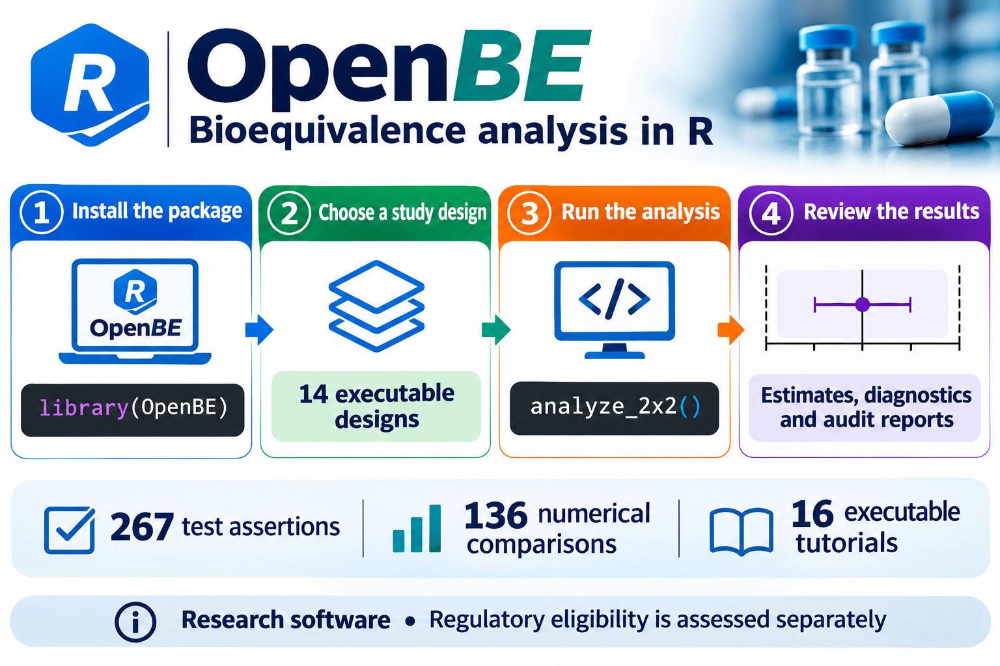
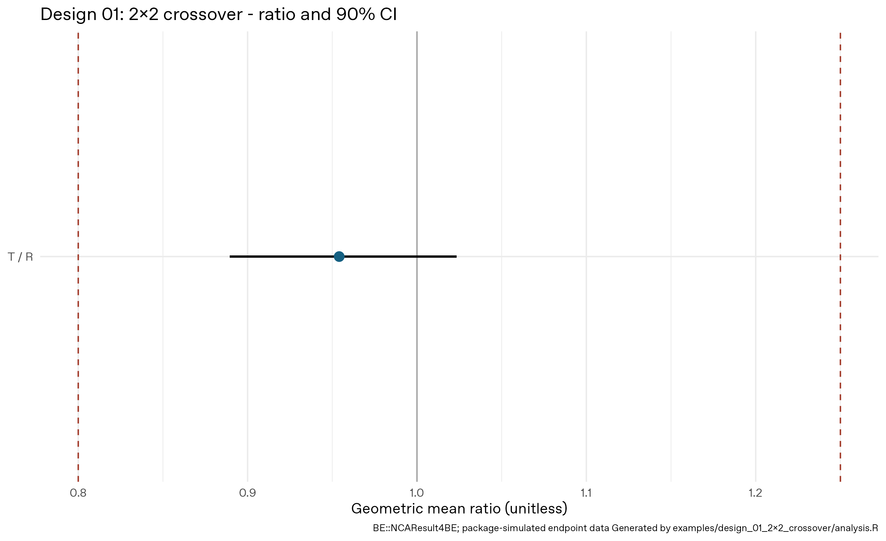
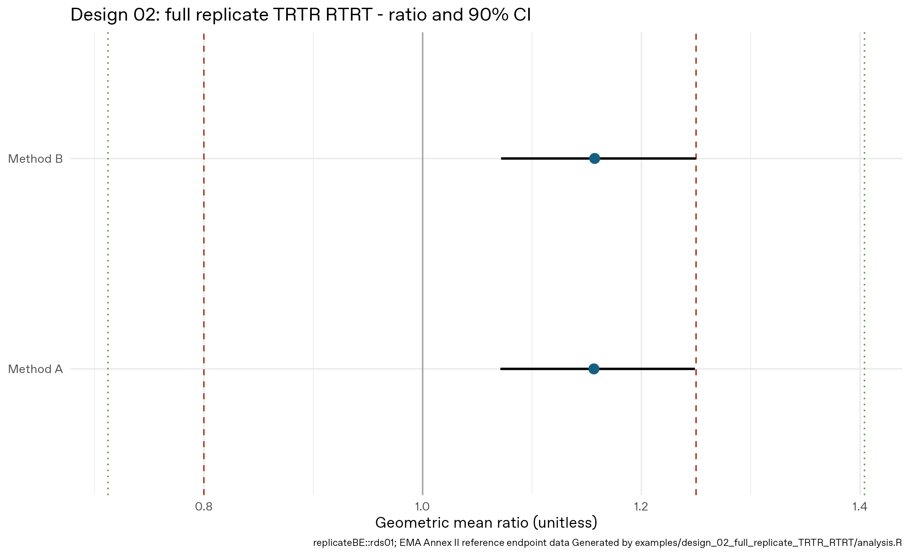

# OpenBE — Bioequivalence analysis in R

OpenBE is an open-source R package for researchers and students who want to
run bioequivalence analyses and trace how the results were produced. Fit a
study design, inspect the estimates and diagnostics, and export a report
that records the analysis population, model and data provenance.

- **Analyze 14 study designs**, including conventional and replicate crossovers,
  parallel groups and Williams designs. Each design has an executable example,
  a tutorial and figures.
- **Work with pharmacokinetic data** using PKNCA for noncompartmental analysis
  and PowerTOST for sample-size and power calculations.
- **Review and reproduce results** with audit reports, recorded dependency
  versions and downloadable figures in PNG and vector PDF.

[Run your first analysis](#quick-start) · [See example figures](#example-figures) ·
[Explore the 14 designs](#supported-designs) · [Review the evidence](#validation)

## Quick start

Install OpenBE from GitHub. The package requires R 4.1 or later and was
tested with R 4.5.0.

```r
install.packages("remotes")
remotes::install_github("fredsevmartins/OpenBE")
```

Run a conventional 2×2 crossover analysis with the included AUClast example.
Inspect the test/reference geometric mean ratio and its 90% confidence
interval, then export the analysis report.

```r
library(OpenBE)

data <- example_dataset(1, "AUClast")
fit <- analyze_2x2(data)

fit$summary
write_analysis(fit, "openbe-report")
```

The report records the analysis population, exclusions, model diagnostics
and input provenance. See the [2×2 tutorial](docs/tutorials/design_01_2x2_crossover.qmd)
for the dataset source, assumptions and interpretation.

## Example figures

These plots are generated by the example scripts and stored in the repository
as PNGs and vector PDFs. The supported designs table links to the full set of
figures for each design.

### Conventional 2×2 crossover

The plot shows the test/reference geometric mean ratio for AUClast and its
90% confidence interval. Dashed lines mark the conventional 0.80 and 1.25
limits used in this example.



[Vector PDF](examples/design_01_2x2_crossover/outputs/AUClast/figures/gmr.pdf) · [Analysis script](examples/design_01_2x2_crossover/analysis.R)

### Full replicate crossover

The plot compares the Cmax estimates and 90% confidence intervals from
replicateBE Methods A and B for the TRTR / RTRT design. The figure illustrates
the numerical analysis of this dataset, including the historical expanded
limits shown in green.



[Vector PDF](examples/design_02_full_replicate_TRTR_RTRT/outputs/Cmax/figures/gmr.pdf) · [Analysis script](examples/design_02_full_replicate_TRTR_RTRT/analysis.R)

### Pharmacokinetics

Mean observed theophylline concentration over time on a semilog scale.



[Vector PDF](examples/pharmacokinetics/outputs/mean_semilog.pdf) · [Tutorial](docs/tutorials/pharmacokinetic_analysis.qmd) · [Figures and outputs](examples/pharmacokinetics/outputs)

### Sample-size planning

Estimated sample size across assumed within-subject variability, expected
test/reference ratio and study design.



[Vector PDF](examples/planning/outputs/sensitivity.pdf) · [Tutorial](docs/tutorials/sample_size_and_power.qmd) · [Figures and outputs](examples/planning/outputs)

## Supported designs

“Tested” below means TESTED_NOT_INDEPENDENTLY_VALIDATED. Targeted independent
mathematical checks have passed; no whole method is classified VALIDATED.
Custom OpenBE implementations remain EXPERIMENTAL.

| Design | Sequences | Periods | Engine | Analytical status | Validation | Tutorial | Figures |
|---|---|---|---|---|---|---|---|
| 01 | TR / RT | 2 | BE | Research workflow | Tested | [Tutorial](docs/tutorials/design_01_2x2_crossover.qmd) | [AUClast](examples/design_01_2x2_crossover/outputs/AUClast/figures) · [Cmax](examples/design_01_2x2_crossover/outputs/Cmax/figures) |
| 02 | TRTR / RTRT | 4 | replicateBE | Research workflow | Tested | [Tutorial](docs/tutorials/design_02_full_replicate_TRTR_RTRT.qmd) | [PNG / PDF](examples/design_02_full_replicate_TRTR_RTRT/outputs/Cmax/figures) |
| 03 | TRRT / RTTR | 4 | replicateBE | Research workflow | Tested | [Tutorial](docs/tutorials/design_03_full_replicate_TRRT_RTTR.qmd) | [PNG / PDF](examples/design_03_full_replicate_TRRT_RTTR/outputs/Cmax/figures) |
| 04 | TTRR / RRTT | 4 | replicateBE | Research workflow | Tested | [Tutorial](docs/tutorials/design_04_full_replicate_TTRR_RRTT.qmd) | [PNG / PDF](examples/design_04_full_replicate_TTRR_RRTT/outputs/Cmax/figures) |
| 05 | TRTR / RTRT / TRRT / RTTR | 4 | replicateBE | Research workflow | Tested | [Tutorial](docs/tutorials/design_05_four_sequence_replicate.qmd) | [PNG / PDF](examples/design_05_four_sequence_replicate/outputs/Cmax/figures) |
| 06 | TRRT / RTTR / TTRR / RRTT | 4 | replicateBE | Research workflow | Tested | [Tutorial](docs/tutorials/design_06_alternative_four_sequence_replicate.qmd) | [PNG / PDF](examples/design_06_alternative_four_sequence_replicate/outputs/Cmax/figures) |
| 07 | TRT / RTR | 3 | replicateBE | Research workflow | Tested | [Tutorial](docs/tutorials/design_07_three_period_full_replicate.qmd) | [PNG / PDF](examples/design_07_three_period_full_replicate/outputs/Cmax/figures) |
| 08 | TRR / RTT | 3 | replicateBE | Research workflow | Tested | [Tutorial](docs/tutorials/design_08_alternative_three_period_replicate.qmd) | [PNG / PDF](examples/design_08_alternative_three_period_replicate/outputs/AUC/figures) |
| 09 | TR / RT / TT / RR | 2 | replicateBE | Research workflow | Tested | [Tutorial](docs/tutorials/design_09_balaam.qmd) | [PNG / PDF](examples/design_09_balaam/outputs/Cmax/figures) |
| 10 | TRR / RTR / RRT | 3 | replicateBE | Research workflow | Tested | [Tutorial](docs/tutorials/design_10_partial_replicate.qmd) | [PNG / PDF](examples/design_10_partial_replicate/outputs/Cmax/figures) |
| 11 | TRR / RTR | 3 | replicateBE | Research workflow | Tested | [Tutorial](docs/tutorials/design_11_extra_reference.qmd) | [PNG / PDF](examples/design_11_extra_reference/outputs/Cmax/figures) |
| 12 | T / R | 1 | stats::lm (OpenBE) | Research workflow | EXPERIMENTAL | [Tutorial](docs/tutorials/design_12_parallel.qmd) | [PNG / PDF](examples/design_12_parallel/outputs/illustrative_endpoint/figures) |
| 13 | ABR / BRA / RAB / RBA / ARB / BAR | 3 | nlme + emmeans (OpenBE) | Research workflow | EXPERIMENTAL | [Tutorial](docs/tutorials/design_13_williams_three_treatments.qmd) | [PNG / PDF](examples/design_13_williams_three_treatments/outputs/illustrative_endpoint/figures) |
| 14 | ABCR / BRAC / RCBA / CARB | 4 | nlme + emmeans (OpenBE) | Research workflow | EXPERIMENTAL | [Tutorial](docs/tutorials/design_14_williams_four_treatments.qmd) | [PNG / PDF](examples/design_14_williams_four_treatments/outputs/illustrative_endpoint/figures) |

Balaam and extra-reference designs are provided for reproducibility and teaching,
with explicit warnings against recommending them for new regulatory studies.
Williams designs involve distinct treatments and are not replicate BE designs.

## Statistical methodology

Natural-log endpoint models produce exponentiated treatment contrasts. BE
supplies the conventional primary ANOVA and estimates; replicateBE supplies
fixed-effect Method A and REML random-intercept Method B. The latter assumes
**a common residual variance**, not a treatment-specific FDA RSABE covariance
model. CVwT is missing where replication cannot identify it. Custom parallel
models assume equal group log variances; Williams models use nlme and emmeans,
unadjusted 90% CIs and separate Holm-adjusted TOST p-values.

See [models and assumptions](docs/statistical-methods.md) and the
[verified capability matrix](docs/technical/PACKAGE_CAPABILITIES.md).

## Validation

Local `R CMD check --no-manual` passed with **Status: OK**. The test suite passed
267 expectations across 29 test blocks, with no failures, errors or skips;
136 recorded expected/observed comparisons passed explicit absolute tolerances.
These include independent stratified-difference and normal-equation checks,
rounded EMA reference-example corroboration, analytical exponential NCA,
input/boundary tests, DF options, Williams balance and reproducible planning.

Read the [validation report](docs/validation/VALIDATION_REPORT.md),
[numerical comparisons](docs/validation/numerical-comparisons.csv) and
[per-design evidence](docs/validation/design-status.csv) for the exact scope.
Shared-engine corroboration is distinguished from independent validation.

## Regulatory scope

OpenBE reports numerical results separately from regulatory eligibility.
All bundled rules are currently unqualified, so the default assessment
returns `REGULATORY_ASSESSMENT_NOT_DETERMINED`. Regulatory use requires
qualification, validation and review of the applicable current guidance.

The replicate workflows include numerical containment and historical ABEL
calculations. FDA RSABE, NTI procedures and AUC scaling eligibility are beyond
the current scope. See the [regulatory framework](docs/regulatory-framework.md)
for the rules and qualification process.

## Development setup

To develop the package or regenerate the examples, clone the repository
and restore the dependencies recorded in `renv.lock`.

```sh
git clone https://github.com/fredsevmartins/OpenBE.git
cd OpenBE
git checkout main
Rscript scripts/install_dependencies.R
R CMD INSTALL .
```

Install Quarto CLI separately (tested: 1.8.27). On a restricted non-root Debian
13 cloud machine, `bash scripts/setup_cloud.sh` provides the tested bootstrap.
It verifies signed Debian package metadata and Quarto's published SHA-256,
and uses immutable CRAN GitHub source pins when direct CRAN access is blocked.
The native package inventory and exact dependency versions are recorded in
[technical documentation](docs/technical/PACKAGE_CAPABILITIES.md).

## Reproduce the examples and documentation

Run these commands from the repository root after installing the package.
The examples command runs all 14 designs, NCA and planning, and regenerates
the corresponding figures and reports.

```sh
Rscript scripts/run_all_examples.R
Rscript scripts/run_validation.R
Rscript scripts/check_package.R
Rscript scripts/build_documentation.R
```

The documentation build writes the Quarto website to `_site/`. Example
outputs are written under `examples/` and source data are kept under
`inst/extdata/`. The [dataset provenance](inst/extdata/PROVENANCE.md)
identifies observed, edited and synthetic data. Recorded package versions,
source pins, input hashes and session files help reproduce the analysis.

The [API reference](docs/api-reference.md) documents the R functions.
GitHub Actions workflows are configured for package checks, numerical
validation and documentation. The checks and site rendering described here
were verified locally. Remote CI results and Pages deployment remain unverified.

## Version 0.1.1

Version 0.1.1 adds population and model audit reports, early estimability
checks, independent REML and degrees-of-freedom comparisons, explicit NCA
policies and unit conversions, and terminal-point exports. The
[technical report](docs/technical/HARDENING_0.1.1.md) covers the changes,
including session-safe contrasts, regulatory qualification gates and
cross-platform checks.

## Citation

Use `citation("OpenBE")` and cite the engines and original datasets used in
an analysis. Machine-readable project citation: [CITATION.cff](CITATION.cff).
See [references](docs/references.md).

## License

OpenBE is **AGPL-3**, compatible with its PKNCA integration. Engine packages and
datasets retain their source licenses and attribution requirements. See
[full license](LICENSE.md), [license inventory](docs/technical/PACKAGE_CAPABILITIES.md)
and [dataset terms](inst/extdata/PROVENANCE.md). No clinical-data relicensing
claim is made.
