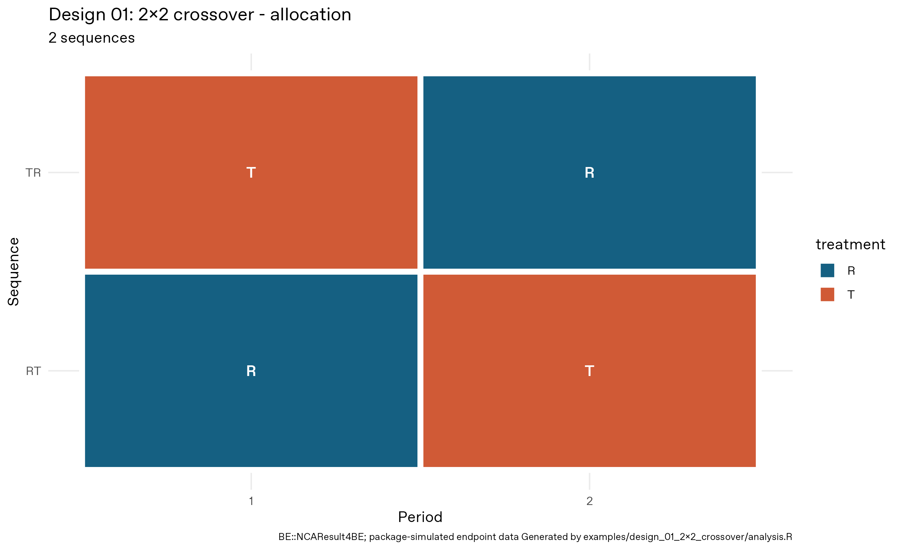
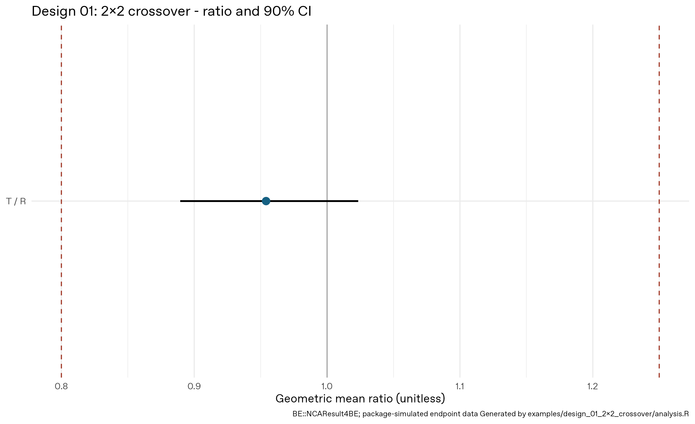
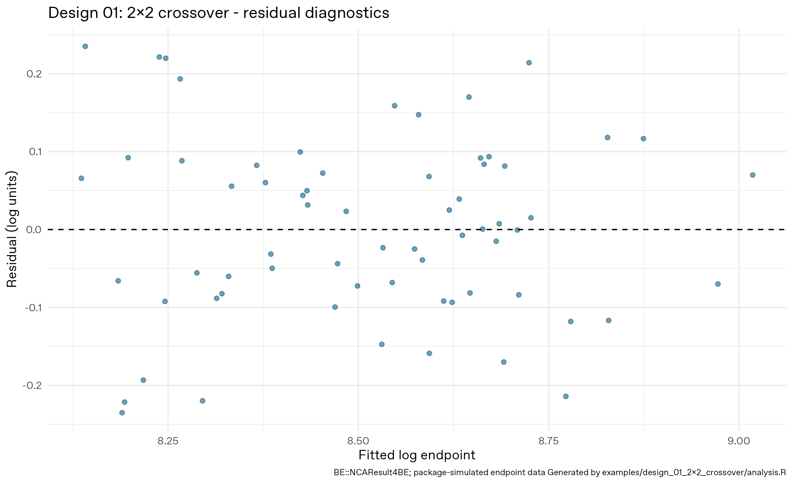
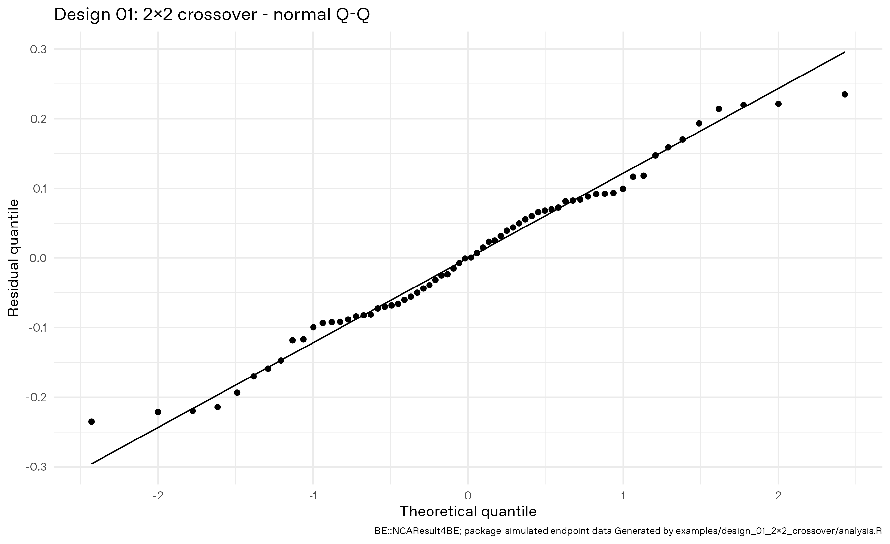

## 1. Introduction

This tutorial is an executable research workflow for **TR | RT**.
It estimates treatment ratios and uncertainty from endpoint-level data while
keeping regulatory applicability separate. Engine: **BE**.
Current classification: **TESTED_NOT_INDEPENDENTLY_VALIDATED**.

## 2. Experimental Design

Sequences: `TR | RT`. Number of periods: 2.
Reference is `R`; Test is `T` in two-treatment examples. Williams examples use
`A`, `B` and (for four treatments) `C` as distinct active formulations.
A subject belongs to exactly one sequence. Intended sequence randomization
supports the design but is not reconstructed from these demonstration records.
See the allocation diagram and the actual per-sequence counts below.

## 3. Statistical Methodology

The primary engine is `BE::test2x2()`, delegating its type III ANOVA and LS means to sasLM. Natural-log AUClast and Cmax are analyzed separately. The subject factor is nested in sequence; sequence is tested against subject(sequence), with period and treatment tested against the residual mean square. The contrast is Test minus Reference; exponentiation gives T/R. Residual DF is N−2 for complete data. The no-carryover assumption is substantive, not established by a sequence p-value.

Model, in symbolic notation:

```text
log(Y_ijk) = mu + sequence_i + subject_j(i) + period_k + treatment_ijk + error_ijk
```

Independent subjects, normally distributed log residuals with a common within-subject variance, adequate washout, complete subject pairs and globally unique subject identifiers. Sequence sizes may differ. Subjects are fixed in the primary analysis; population generalization needs scientific justification. The geometric LS means are exponentiated adjusted means, not arithmetic endpoint means.

For each T/R contrast the conventional equivalence hypotheses are
`H01: log(T/R) <= log(0.80)` and `H02: log(T/R) >= log(1.25)`.
The mathematical interval check asks whether the unrounded two-sided 90% CI
is contained within [0.80, 1.25]. It does not select a regulatory policy.
CV on the original scale is `sqrt(exp(log_variance)-1)` and is reported as a
fraction in machine-readable summaries; multiply by 100 for percent.

## 4. Dataset

**BE::NCAResult4BE; package-simulated endpoint data.** Endpoint: `AUClast/Cmax`. No measured concentration-time
profiles are available for this endpoint example. Endpoint units are not
reinterpreted; ratios and CVs are unitless. Original variables and data types
are retained in the pinned source packages. Packaged CSVs use a common schema:
`subject`, `sequence`, `period`, `treatment`, `PK` (and source logPK if present).

See [dataset provenance](../../inst/extdata/PROVENANCE.md) for source terms,
original citations, source simulations and the full OpenBE generation model.
No simulation parameters or seeds are invented for historical package data.

## 5. R Implementation

Install OpenBE and dependencies first, then render from the repository root with
`quarto render docs/tutorials/design_01_2x2_crossover.qmd`. The same analysis runs independently:
`Rscript examples/design_01_2x2_crossover/analysis.R`.

```{r}
library(OpenBE)
d <- example_dataset(1, "AUClast")
result <- analyze_2x2(d)
cmax <- analyze_2x2(example_dataset(1, "Cmax"))
output <- "examples/design_01_2x2_crossover/outputs/AUClast"
write_analysis(result, output)
plot_analysis(result, file.path(output, "figures"),
              "Design 01: 2x2 crossover",
              "BE::NCAResult4BE; package-simulated endpoint data",
              "examples/design_01_2x2_crossover/analysis.R")
```

## 6. Results

The following tables are computed during rendering; no numerical table is
handwritten. The primary interval and ratio columns use the **ratio** scale,
not percentage points. The CV columns, where present, are fractions.

```{r}
result$summary
table(result$data$sequence)
summary(result$model)
if (!is.null(result$anova)) result$anova
if (!is.null(result$geometric_lsmeans)) result$geometric_lsmeans
```

```{r}
cmax$summary
cmax$anova
cmax$geometric_lsmeans
```

## 7. Scientific Figures

PNG files are exported at 300 dpi and corresponding PDF vector files are saved
alongside them. Every caption identifies provenance and its generating script.
Residual diagnostics use the primary fixed-effects model in replicate examples;
these are Method A diagnostics, not a separate validation of Method B.









## 8. Interpretation

`abe_numeric` describes interval containment only. A ratio near one estimates
similar geometric exposure, but its uncertainty matters. `abel_numeric`, when
present, combines historical expanded-limit containment with the 0.80–1.25 GMR
restriction; it does not establish endpoint eligibility. Compare methods by
estimates, CI widths, DF and variance assumptions, rather than choosing the
method that yields a desired pass. Diagnostic plots support review, not
automatic outlier deletion.

```{r}
result$regulatory[c("classification", "reason")]
```

## 9. Regulatory Considerations

Current EMA/ICH/FDA rule applicability has **not** been verified from official
sources in this restricted environment. Historical engine constants and package
support are not evidence of a current regulatory acceptance policy. In
particular, do not apply Cmax-style expansion indiscriminately to AUC.
See the [regulatory framework](../regulatory-framework.md) for official source
locations, failed retrieval status and the distinction between statistics,
eligibility and classification. The result remains
`REGULATORY_ASSESSMENT_NOT_DETERMINED`.

## 10. Limitations

The source package dataset is simulated, contains endpoint values only and is not evidence from a clinical trial. A sequence effect is not a definitive test for carryover. Both AUClast and Cmax must be interpreted within the intended study framework.

This workflow is research software. It does not establish assay validity,
clinical data integrity, washout adequacy, clinical similarity, product-specific
eligibility or regulatory approval. Missing data are never imputed silently.
Review the analysis population and predefine the missingness and outlier policy.

## 11. Reproducibility

The standalone script writes CSV results, its RDS model bundle, session details,
regulatory status and figures into `outputs/AUClast`. CSV input copies are
saved in this example directory. R 4.5.0 and exact package versions from the
implementation run are recorded in the technical audit and `renv.lock`.
For synthetic designs 12–14, seeds 12012, 13013 and 14014 respectively and all
variance parameters are documented in dataset provenance.

```{r}
sessionInfo()
```

Targeted independent checks and their tolerances are in the
[validation report](../validation/VALIDATION_REPORT.md) and
[numerical comparisons](../validation/numerical-comparisons.csv). Successful
execution alone is not independent validation; this tutorial's classification
is **TESTED_NOT_INDEPENDENTLY_VALIDATED**.

## 12. References

- BE installed help and pinned CRAN source, listed in the
  [capability audit](../technical/PACKAGE_CAPABILITIES.md).
- Original data citation and source terms: [provenance](../../inst/extdata/PROVENANCE.md).
- Chow SC, Liu JP. *Design and Analysis of Bioavailability and Bioequivalence
  Studies*. 3rd ed. CRC Press; 2009.
- Pinheiro JC, Bates DM. *Mixed-Effects Models in S and S-PLUS*. Springer; 2000.
- Historical EMA Annex I (2016), as cited by replicateBE 1.1.3; its present
  applicability is not asserted. Current-source verification register:
  [regulatory framework](../regulatory-framework.md).
