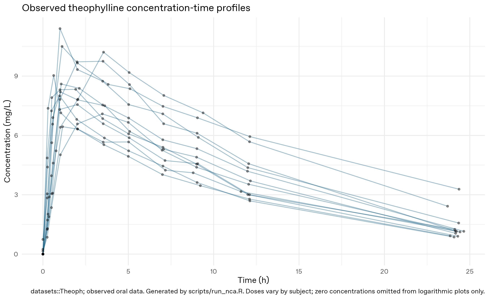
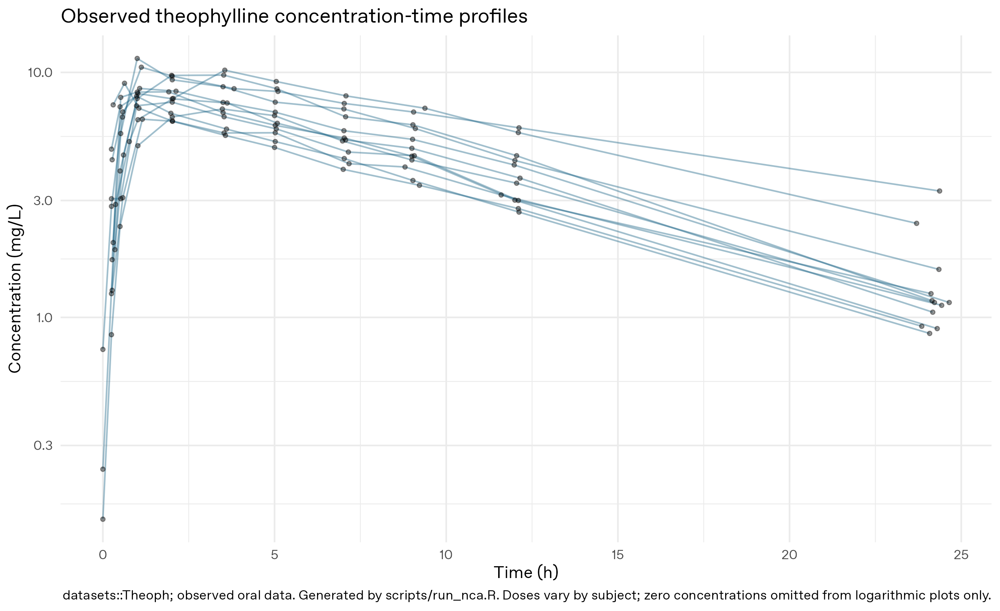

## Data and scientific scope

The observed `datasets::Theoph` dataset contains 12 subjects given oral
Theophylline, 11 samples per subject and subject-specific doses in mg/kg.
Concentrations are mg/L; time is hours. Actual sampling times differ among
subjects; the packaged `theoph.csv` preserves those times and original doses.
Source: Boeckmann, Sheiner and Beal, NONMEM Users Guide Part V (1994).
This module uses PKNCA 0.12.1. No endpoint-only BE dataset is used to fabricate
measured concentration-time profiles.

## Methods and data handling

The wrapper requires explicit intervals, units and positive doses. It rejects
negative concentrations, duplicate subject-time records, missing or nonfinite
observations and unequal subject coverage between dose and concentration data.
Study-specific missing/BLQ handling belongs in a prespecified upstream policy.
Zero concentrations are BLQ under PKNCA's explicit default policy: first and
last BLQ are kept, middle BLQ dropped. This default is recorded, not endorsed
for every assay. The example does not invent an LLOQ or subtract measured
predose concentrations. That choice affects the scientific interpretation.

AUC uses linear-up/log-down trapezoids. Cmax/Tmax are observed maxima and the
first associated time. Terminal phase estimation uses the engine's adjusted
R-squared selection with at least three points, excluding Tmax by default;
`adj.r.squared.factor=0.0001`. Automatic selection does not guarantee a reliable
terminal phase. Inspect selected points, span, goodness of fit and extrapolated
percentage. The implementation run records all PKNCA options in the outputs.
For positive terminal estimates, half-life is log(2)/lambda.z, AUCinf adds the
last observed concentration divided by lambda.z, and extrapolation percent is
100*(AUCinf−AUClast)/AUCinf. Nonestimable terminal parameters must remain missing,
never replaced by invented values.

## Executable analysis and results

```{r}
library(OpenBE)
source("scripts/run_nca.R")
head(dose)
intervals
summary(nca)
as.data.frame(nca)
```

The output includes Cmax, Tmax, AUClast, AUCinf.obs, lambda.z, half.life and
aucpext.obs where estimable. Dose-normalized clearance is not requested because
the selected endpoints do not require it; declared dose units are retained as
metadata and are not automatically converted. Review per-parameter exclusion
reasons in the PKNCAresults table before interpreting missing values.

## Figures









## Multiple-dose interval example

Explicitly labeled synthetic steady-state IV-bolus illustration, **not observed
Theoph data**: an initial steady-state concentration `10/(1-exp(-0.1*12))`,
elimination rate 0.1/h, doses at 0 and 12 h. An interval [0,12] integrates
exposure over tau; the analytical AUCtau is 100 mg·h/L. No regulatory steady-state
criterion is inferred from calling an interval calculator.

```{r}
t <- 0:12
synthetic <- data.frame(subject=1,time=t,
                        concentration=10/(1-exp(-1.2))*exp(-.1*t))
repeat_dose <- data.frame(subject=1,time=c(0,12),dose=100)
tau <- data.frame(start=0,end=12,auclast=TRUE,cmax=TRUE,tmax=TRUE)
analyze_nca(synthetic,repeat_dose,tau,"mg/L","h","mg")
```

## Validation and reproduction

Tests independently check analytical exponential integrals, lambda.z,
half-life, Cmax/Tmax, AUCinf and extrapolation percentage. The observed Theoph
example is **TESTED_NOT_INDEPENDENTLY_VALIDATED**, not clinical NCA qualification.
Terminal selection, BLQ policy, assay suitability, extrapolation thresholds and
multiple-dose steady-state eligibility need study-specific review.
Run `Rscript scripts/run_nca.R` from the project root. Numerical outputs, model
bundle, figures and options are in `examples/pharmacokinetics/outputs`.

```{r}
sessionInfo()
```

## References

- Denney W, Duvvuri S, Buckeridge C. Simple, Automatic Noncompartmental Analysis:
  The PKNCA R Package. J Pharmacokinet Pharmacodyn. 2015;42:S65.
- PKNCA installed introduction, half-life and data-handling help, version 0.12.1.
- Boeckmann AJ, Sheiner LB, Beal SL. NONMEM Users Guide, Part V. 1994.
- [Dataset provenance](../../inst/extdata/PROVENANCE.md) and
  [validation report](../validation/VALIDATION_REPORT.md).
