## Purpose and assumptions

PowerTOST 1.5-7 is the planning engine. Planning is not endpoint analysis and
its supported design list is not proof that an analysis package supports the
same design. Inputs are within-subject CV (fraction), expected geometric ratio,
conventional limits 0.80–1.25, alpha 0.05 and target power 0.80. The classical
2×2 example assumes normally distributed log endpoints and a common residual
variance. A replicate study requires additional variance assumptions; the
one-CV interface here assumes common Test/Reference variability for planning.

## Executable conventional example

```{r}
library(OpenBE)
p <- plan_be(cv = 0.20, ratio = 0.95, power = 0.80, design = "2x2")
p
PowerTOST::power.TOST(CV = .20, theta0 = .95,
                     n = p[["Sample size"]], design = "2x2")
PowerTOST::known.designs()
```

The returned sample size is the total across sequences, not subjects per
sequence. Achieved power is recomputed by the engine after the integer sample
size is chosen. Inflating for dropout is a separate design decision.

## CV, ratio and design sensitivity

```{r}
source("scripts/run_planning.R")
results
```



Higher assumed variability and ratios farther from one commonly increase the
required sample size. This is sensitivity analysis, not an empirical estimate
of an unknown study's power. Study-design comparisons use the engine's stated
models and common input CV; they do not establish cost or regulatory superiority.

## Reference-scaled planning

```{r}
scaled <- plan_be(cv = .40, ratio = .95, design = "2x2x4", scaled = TRUE,
                  seed = 20261115, nsims = 10000)
scaled
```

This delegates to `sampleN.scABEL(regulator="EMA", setseed=FALSE)` after setting
and subsequently restoring R's RNG state. Monte Carlo error is nonzero; with
10,000 independent simulated decisions a binomial standard error near 80%
power is approximately 0.004. The engine may use variance-reduction or other
simulation procedures, so this is an orientation rather than an exact interval
for every internal estimator. For final planning, inspect the engine's methods,
use adequate simulations and vary assumed parameters.

Historical EMA constants are a computational scenario; current endpoint and
regulatory eligibility remain unqualified. This is not FDA RSABE. Additional
PowerTOST functions such as adjusted-alpha scaled planning are not silently
substituted. Review consumer-risk control when relevant.

## Validation, limitations and reproduction

Conventional output is checked against PowerTOST's power calculation and the
documented n=20 example at CV 0.20 and ratio 0.95. Scaled output is tested for
repeatability and RNG restoration, not independently qualified. Planning is
TESTED_NOT_INDEPENDENTLY_VALIDATED. Reproduce with
`Rscript scripts/run_planning.R`; outputs include numerical CSVs, PNG/PDF and
session information. See [validation](../validation/VALIDATION_REPORT.md).

```{r}
sessionInfo()
```

## References

- PowerTOST installed `sampleN.TOST`, `power.TOST`, `sampleN.scABEL` and
  `known.designs` help; version/source pins in the capability matrix.
- Chow SC, Liu JP. Design and Analysis of Bioavailability and Bioequivalence
  Studies. 3rd ed. CRC Press; 2009.
- [Regulatory framework and current-source verification limits](../regulatory-framework.md).
